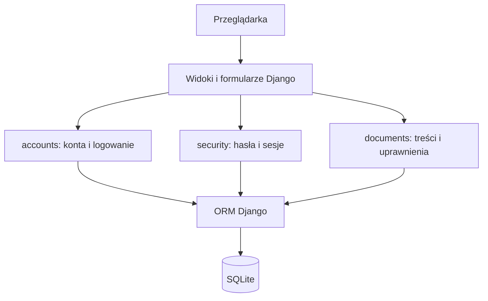

# Plan techniczny modułu identyfikacji uwierzytelniania i autoryzacji

Status: propozycja implementacji  
Wersja: 0.1  
Data: 2026-10-22  
Podstawa: [spec.md](spec.md), wersja 0.2

## 1. Cel i sposób pracy

Zbudujemy edukacyjną aplikację webową do zarządzania kontami, hasłami i dostępem do dokumentów. Plan przekłada zachowanie opisane w specyfikacji na architekturę, model danych, etapy implementacji i sposób weryfikacji.

Pracujemy zgodnie z SDD: `spec.md` określa zachowanie, `plan.md` opisuje rozwiązanie techniczne, a przyszły `tasks.md` będzie zawierał zadania wykonawcze. Jeżeli implementacja wymaga zmiany zachowania, najpierw aktualizujemy specyfikację i odpowiednie kryteria odbioru.

Ten etap obejmuje przygotowanie planu. Utworzenie aplikacji, instalacja zależności, publikacja repozytorium i wdrożenie są odrębnymi działaniami.

## 2. Stos technologiczny

| Obszar | Wybór | Uzasadnienie |
|---|---|---|
| Język | Python 3.13, aktualne wydanie poprawkowe | Jedna wersja bazowa w środowisku lokalnym i CI |
| Framework | Django 5.2 LTS, aktualne wydanie poprawkowe | ORM, migracje, formularze, szablony, sesje i ochrona CSRF w jednym projekcie |
| Interfejs | Szablony Django, HTML, własny CSS, niewielkie skrypty JavaScript | Renderowanie na serwerze i wspólna walidacja formularzy |
| Baza lokalna i testowa | SQLite | Uruchomienie bez osobnego serwera bazy danych |
| Przechowywanie haseł | `Argon2PasswordHasher` z `argon2-cffi` | Argon2id poprzez mechanizm haseł Django |
| Sesje | Sesje Django przechowywane w bazie | Unieważnianie po stronie serwera; przeglądarka przechowuje identyfikator sesji |
| Zależności | `uv`, `pyproject.toml`, `uv.lock` | Powtarzalne środowisko oraz wspólne ustawienia narzędzi |
| Testy | `pytest`, `pytest-django`, klient testowy Django | Testy reguł, integracji z bazą i żądań HTTP |
| Styl kodu | Ruff | Sprawdzanie i formatowanie kodu |
| Automatyzacja | GitHub Actions | Kontrole na push i pull request |

Django 5.2 jest wydaniem LTS, a Python 3.13 znajduje się w jego macierzy zgodności. Wersje poprawkowe zależności wybierzemy i zablokujemy przy inicjalizacji projektu. [Cykl wsparcia Django](https://www.djangoproject.com/download/), [zgodność z Pythonem](https://docs.djangoproject.com/en/5.2/faq/install/#what-python-version-can-i-use-with-django)

Konfiguracja `PASSWORD_HASHERS` będzie jawnie wskazywała Argon2 jako pierwszy algorytm. Samo zainstalowanie biblioteki nie zmienia domyślnego hashera. [Konfiguracja Argon2id](https://docs.djangoproject.com/en/5.2/topics/auth/passwords/#using-argon2-with-django)

Plik `uv.lock` trafi do repozytorium, a środowisko `.venv` pozostanie lokalne. [Struktura projektu uv](https://docs.astral.sh/uv/concepts/projects/layout/)

## 3. Architektura

Projekt będzie pojedynczą aplikacją Django podzieloną na trzy moduły domenowe. Widoki obsługują HTTP, formularze walidują dane wejściowe, serwisy wykonują operacje biznesowe, a modele i zapytania odpowiadają za zapis oraz odczyt danych.



### 3.1. Odpowiedzialności modułów

| Moduł | Odpowiedzialności |
|---|---|
| `accounts` | Własny model użytkownika, role, logowanie, panel kont, blokowanie, logiczne usuwanie i komendy inicjalizacyjne |
| `security` | Ustawienia bezpieczeństwa, historia haseł, hasła tymczasowe, zmiana hasła, ograniczony dostęp i wygaszanie sesji |
| `documents` | Dokumenty, lista i szczegóły, szkice, publikacja, filtrowanie danych i polityki dostępu do obiektów |
| `config` | Ustawienia środowisk, adresy główne, uruchomienie i konfiguracja frameworka |

Moduły bezpieczeństwa i dokumentów odnoszą się do użytkownika przez `AUTH_USER_MODEL`. Wspólne reguły dotyczące haseł i sesji nie są kopiowane do widoków administracyjnych ani komend.

### 3.2. Struktura repozytorium

```text
.
├── README.md
├── pyproject.toml
├── uv.lock
├── .python-version
├── .gitignore
├── .env.example
├── manage.py
├── config/
│   ├── settings/
│   │   ├── base.py
│   │   ├── local.py
│   │   ├── test.py
│   │   └── production.py
│   ├── urls.py
│   ├── asgi.py
│   └── wsgi.py
├── apps/
│   ├── accounts/
│   │   ├── models.py
│   │   ├── forms.py
│   │   ├── views.py
│   │   ├── services.py
│   │   ├── backends.py
│   │   ├── management/commands/
│   │   └── migrations/
│   ├── security/
│   │   ├── models.py
│   │   ├── forms.py
│   │   ├── views.py
│   │   ├── services.py
│   │   ├── validators.py
│   │   ├── middleware.py
│   │   └── migrations/
│   └── documents/
│       ├── models.py
│       ├── forms.py
│       ├── views.py
│       ├── services.py
│       ├── policies.py
│       ├── selectors.py
│       └── migrations/
├── templates/
│   ├── base.html
│   ├── accounts/
│   ├── security/
│   ├── documents/
│   └── errors/
├── static/
│   ├── css/
│   └── js/
├── tests/
│   ├── conftest.py
│   ├── accounts/
│   ├── security/
│   └── documents/
├── docs/
│   └── decisions/
├── specs/
│   └── 001-identity-access/
│       ├── spec.md
│       ├── plan.md
│       └── tasks.md
└── .github/
    └── workflows/ci.yml
```

To docelowy układ. Pliki tworzymy wtedy, gdy pojawia się ich odpowiedzialność; nie wypełniamy projektu pustymi abstrakcjami. Pliki inicjalizacyjne pakietów pominięto na schemacie.

## 4. Model danych

### 4.1. User

Własny model oparty na `AbstractUser` powstanie przed pierwszą migracją. Późniejsza wymiana modelu użytkownika wymagałaby zmian relacji i danych. [Własny model użytkownika](https://docs.djangoproject.com/en/5.2/topics/auth/customizing/#using-a-custom-user-model-when-starting-a-project)

| Pole | Przeznaczenie |
|---|---|
| `username` | Login prezentowany użytkownikowi, niezmienny po utworzeniu |
| `login_key` | Unikalny klucz wyszukiwania: `username.strip().casefold()` |
| `first_name`, `last_name` | Dane prezentowane na liście kont |
| `role` | Jedna wartość z pięciu ról |
| `is_active` | Możliwość logowania; blokada ustawia `False` |
| `deleted_at` | Znacznik logicznego usunięcia |
| `password` | Hash ostatniego hasła stałego; przed jego ustawieniem znacznik hasła nieużywalnego Django |
| `password_changed_at` | Początek ważności hasła stałego |
| `credential_mode` | Tryb `INITIAL`, `TEMPORARY` lub `PERMANENT` |
| `session_version` | Licznik unieważniający istniejące pełne i ograniczone sesje |

`login_key` ma ograniczenie unikalności w bazie. Porównanie niezależne od wielkości liter nie opiera się wyłącznie na `iexact`, ponieważ SQLite ma ograniczenia porównań znaków spoza ASCII. Hasła pozostają bez normalizacji i usuwania spacji. [Porównania tekstu w SQLite](https://docs.djangoproject.com/en/5.2/ref/models/querysets/#iexact)

Tryb `INITIAL` służy wyłącznie pierwszemu hasłu `ADMIN` podanemu lokalnie przez operatora i wymusza jego zmianę. Pozostałe nowe konta rozpoczynają w trybie `TEMPORARY`.

`ADMIN` jest rolą aplikacji. Konto to nie otrzyma `is_superuser=True` ani nieograniczonego dostępu do szkiców. Publiczna konfiguracja adresów nie udostępni wbudowanego panelu Django Admin; panel projektu będzie korzystał z tych samych serwisów i reguł co pozostałe widoki.

### 4.2. SecuritySettings

Jeden rekord o stałym identyfikatorze, tworzony migracją danych:

| Pole | Wartość początkowa |
|---|---|
| `levenshtein_enabled` | `True` |
| `password_max_age_days` | `0` — bez okresowego wygasania |
| `idle_timeout_minutes` | `15` |
| `updated_at` | Czas ostatniej zmiany |

Minimalna długość `14`, próg odległości `4`, historia `5`, długość hasła tymczasowego `16` i jego ważność `4 h` będą nazwanymi stałymi w module bezpieczeństwa. Interfejs nie będzie umożliwiał ich zmiany. Ustawienia z bazy odczytujemy przy żądaniu bez trwałego cache, aby zmiana obowiązywała od następnego żądania.

### 4.3. PasswordHistory

Rekord zawiera użytkownika, hash wycofanego hasła stałego i czas jego zastąpienia. `User.password` pozostaje hashem bieżącego lub ostatnio ustawionego hasła stałego. Historia przechowuje do pięciu wcześniejszych wartości.

Reset blokuje logowanie hasłem stałym przez zmianę `credential_mode`, ale nie usuwa jego hasha. Dzięki temu po resecie nadal można odrzucić bieżące i pięć poprzednich haseł bez wypierania ich przez hasła tymczasowe. Kod logowania hasłem stałym musi jawnie wymagać trybu `PERMANENT` albo ograniczonej ścieżki `INITIAL`.

### 4.4. TemporaryCredential

Rekord zawiera użytkownika, hash hasła tymczasowego, `issued_at`, `expires_at`, `consumed_at`, `revoked_at` oraz wersję poświadczenia zgodną z `session_version`. Wydanie nowego hasła unieważnia wcześniejsze. Surowe hasło istnieje tylko w pamięci obsługi operacji i w jednorazowej odpowiedzi dla administratora.

Zużyty hash może posłużyć do ponownego potwierdzenia hasła tymczasowego wyłącznie w przypisanej ograniczonej sesji zmiany hasła. Nie może utworzyć kolejnej sesji logowania.

### 4.5. Document

Dokument zawiera `title`, `body`, `author`, `status`, `created_at` i `updated_at`. Dopuszczalne stany to `DRAFT` i `PUBLISHED`. Relacja autora jest chroniona przed fizycznym usunięciem, a logiczne usunięcie konta zachowuje autorstwo.

### 4.6. Ograniczenia i spójność

- Walidujemy wartości ustawień w formularzach, serwisach i ograniczeniach bazy tam, gdzie regułę da się wyrazić deklaratywnie.
- Chronimy powiązanie zarezerwowanego loginu `ADMIN` z rolą Administrator. Pozostałe konta nie mogą uzyskać tej roli.
- Operacje resetu, zmiany hasła, blokady i zmiany roli wykonują się w transakcjach.
- Zmiana hasła obejmuje jednocześnie hash, historię, datę zmiany, tryb poświadczeń i wersję sesji.
- Widoki i komendy korzystają z serwisów domenowych zamiast niezależnych operacji zapisu.

## 5. Logowanie i cykl życia haseł

### 5.1. Zwykłe logowanie

1. Formularz oblicza klucz loginu, pozostawiając hasło bez zmian.
2. Serwis wyszukuje konto i sprawdza jego stan oraz dopuszczalny tryb poświadczeń.
3. Weryfikacja hasha odbywa się przez mechanizm Django. Dla nieistniejącego konta również wykonujemy kosztowną weryfikację zastępczą; nie deklarujemy pełnej stałoczasowości całej odpowiedzi HTTP.
4. Niepowodzenie kończy się wspólnym komunikatem ze specyfikacji, bez ujawniania stanu konta.
5. Aktywne i niewygasłe hasło stałe tworzy pełną sesję przez mechanizm logowania Django.
6. Hasło wygasłe albo początkowe hasło `ADMIN` tworzy wyłącznie ograniczoną sesję zmiany hasła.

Własny backend nie będzie miał ścieżki awaryjnej do domyślnego backendu, która pozwalałaby ominąć sprawdzenie trybu poświadczeń. Weryfikacja logowania i ustalenie zakresu sesji będą rozdzielonymi operacjami.

### 5.2. Hasło tymczasowe

1. Serwis tworzenia lub resetu generuje 16 znaków z alfabetu `A–Z`, `a–z`, `0–9` przez `secrets.choice`, następnie oblicza hash. [Bezpieczna losowość w Pythonie](https://docs.python.org/3.13/library/secrets.html)
2. Transakcja ustawia tryb `TEMPORARY`, zwiększa `session_version`, unieważnia wcześniejsze poświadczenia tymczasowe i zapisuje nowe z terminem ważności za 4 godziny.
3. Administrator otrzymuje hasło w odpowiedzi z `Cache-Control: no-store`. Nie zapisujemy go w sesji, kolejce komunikatów Django ani adresie URL. Odświeżenie listy kont nie pozwala ponownie go odczytać.
4. Przy logowaniu aplikacja weryfikuje hash i termin, a następnie atomowo oznacza poświadczenie jako zużyte. Warunkowa aktualizacja musi zmodyfikować dokładnie jeden nadal ważny i niezużyty rekord, przy zgodnej wersji konta.
5. Tylko zwycięska operacja tworzy ograniczoną sesję. Jej awaria po zużyciu hasła wymaga kolejnego resetu, zgodnie ze specyfikacją.
6. Formularz zmiany ponownie prosi o hasło tymczasowe. Weryfikuje je w kontekście tej sesji i stosuje aktywną regułę Levenshteina.

Surowe hasła i formularze uwierzytelniania oznaczymy jako dane wrażliwe w raportach błędów. Nie będą trafiały do logów żądań ani parametrów poleceń.

### 5.3. Wspólny serwis zmiany hasła

Serwis otrzymuje użytkownika, powód zmiany, stary sekret oraz dwa pola nowego hasła. Sprawdza:

1. Uprawnienie do zmiany w bieżącej pełnej lub ograniczonej sesji.
2. Zgodność starego sekretu z odpowiednim hashem.
3. Zgodność potwierdzenia i minimalną długość 14 znaków.
4. Listę popularnych haseł przez walidator Django.
5. Brak ponownego użycia hasła bieżącego i pięciu poprzednich haseł stałych.
6. Odległość Levenshteina co najmniej 4, gdy reguła jest włączona.

Odległość implementujemy jako małą, czystą funkcję operującą na znakach tekstu, z kosztami operacji równymi 1. Nie jest to mechanizm kryptograficzny. Funkcja będzie testowana oddzielnie, także dla pustych ciągów, polskich znaków, spacji i różnic wielkości liter.

Po walidacji transakcja przenosi dotychczasowy hash stały do historii, ogranicza ją do pięciu poprzednich wartości, zapisuje nowy hash oraz czas zmiany, ustawia tryb `PERMANENT`, unieważnia poświadczenia tymczasowe i zwiększa wersję sesji. Jeżeli stan konta zmienił się od rozpoczęcia operacji, zapis nie może nadpisać nowszego resetu lub zmiany hasła.

Po sukcesie usuwamy bieżącą sesję i kierujemy do logowania. Nie zachowujemy jej mechanizmem aktualizacji hasha uwierzytelnienia, ponieważ specyfikacja wymaga ponownego logowania po każdej zmianie hasła.

### 5.4. Transakcje i równoczesne operacje

SQLite skonfigurujemy w trybie transakcji `IMMEDIATE`, z krótkimi transakcjami serwisów oraz kontrolą wersji rekordu konta. Nie włączamy transakcji obejmującej każde całe żądanie. Kosztowne hashowanie wykonujemy poza blokadą, a w transakcji ponownie sprawdzamy wersję i stan danych użytych do walidacji.

Warunkowa aktualizacja poświadczenia i sprawdzenie liczby zmienionych rekordów są wymagane niezależnie od silnika bazy. `select_for_update()` nie zapewnia blokady w SQLite; nie opieramy na nim jednorazowości hasła. [Transakcje i ograniczenia SQLite](https://docs.djangoproject.com/en/5.2/ref/databases/#sqlite-notes)

Równoczesne użycie hasła i reset sprawdzimy na osobnych połączeniach do plikowej bazy testowej. Błąd blokady nie może skutkować przyznaniem dostępu ani częściowym zapisem. Obsłużymy go jako nieudaną operację z możliwością ponowienia.

## 6. Sesje i aktualne ustawienia

### 6.1. Trzy poziomy dostępu

| Stan | Dane sesyjne | Dozwolone operacje |
|---|---|---|
| Anonimowy | Brak poświadczenia dostępu | Formularz logowania |
| Ograniczony | Identyfikator konta, powód zmiany, wersja konta, czas aktywności; dla resetu identyfikator poświadczenia i jego termin | Zmiana hasła i wylogowanie |
| Pełny | Dane logowania Django, wersja konta i czas aktywności | Operacje wynikające z roli |

Ograniczona sesja nie wywołuje zwykłego `login()` i nie ustawia uwierzytelnionego użytkownika Django. Dostęp do formularza zmiany obsługuje osobny kontroler, korzystający z danych zapisanych w serwerowej sesji. Przy zmianie kontekstu obracamy klucz sesji mechanizmem Django.

### 6.2. Sprawdzanie żądania

Middleware bezpieczeństwa działa po `SessionMiddleware` i `AuthenticationMiddleware`. Dla pełnego i ograniczonego kontekstu:

1. Pobiera aktualne konto i ustawienia bezpieczeństwa.
2. Odrzuca konto nieaktywne lub usunięte oraz niezgodną `session_version`.
3. Sprawdza limit bezczynności przed aktualizacją czasu; `teraz >= ostatnia_aktywność + limit` oznacza koniec sesji.
4. W ograniczonej sesji po resecie sprawdza również pierwotny termin poświadczenia tymczasowego.
5. W pełnej sesji sprawdza ważność hasła stałego i w razie potrzeby przełącza dostęp na ograniczony kontekst zmiany hasła.
6. Dopiero po pomyślnej kontroli aktualizuje aktywność dla widoku aplikacji.

Zasoby statyczne nie przechodzą przez odnowienie aktywności. Nie tworzymy automatycznego odpytywania podtrzymującego sesję. Ewentualny lokalny licznik w interfejsie ma wyłącznie funkcję informacyjną.

Reset, zmiana hasła, blokada, logiczne usunięcie i zmiana roli zwiększają wersję konta. Stare sesje tracą prawo dostępu natychmiast w bazie, a ich kolejne żądanie kończy się usunięciem sesji. Nie skanujemy wszystkich rekordów sesji przy każdej operacji na koncie.

Ważność hasła liczymy od `password_changed_at` według aktualnej liczby dni. Wartość `0` wyłącza tę kontrolę. Zmiana ustawień nie nadpisuje czasu ostatniej zmiany hasła ani czasu aktywności użytkownika.

### 6.3. Konfiguracja frameworka

Korzystamy z bazowego silnika sesji Django, a nie sesji przechowywanych w podpisanym ciasteczku. Kontrola limitu pozostaje po stronie aplikacji; samo ustawienie `SESSION_COOKIE_AGE` nie zastąpi sprawdzania aktualnego limitu i aktywności. [Dokumentacja sesji Django](https://docs.djangoproject.com/en/5.2/topics/http/sessions/)

Ciasteczko sesyjne ma `HttpOnly` i `SameSite=Lax`. Konfiguracja HTTPS ustawia także `Secure`. Widoki chronione i odpowiedź zawierająca hasło tymczasowe mają zakaz przechowywania w cache. Wylogowanie jest operacją POST chronioną CSRF i korzysta z unieważnienia sesji po stronie serwera.

## 7. Role i kontrola dostępu

Jedynym źródłem roli jest `User.role`. Reguły operacji definiujemy jawnie w politykach; nie utrzymujemy drugiej, niezależnej macierzy w grupach Django. Wbudowane pola grup i indywidualnych uprawnień nie będą nadawane przez interfejs ani używane jako obejście polityk aplikacji.

- Polityka odpowiada na pytanie, czy konto może wykonać daną operację na wskazanym dokumencie.
- Selektory budują listę dokumentów widocznych dla roli i autora.
- Widok szczegółów odróżnia brak obiektu (404) od braku uprawnienia do istniejącego obiektu (403), zgodnie ze specyfikacją.
- Serwis zapisu ponownie sprawdza uprawnienie i aktualny stan dokumentu. Ukrycie przycisku nie zastępuje tej kontroli.
- Autor jest przypisywany z kontekstu użytkownika, a pola formularza nie mogą zmienić autora ani dowolnie ustawić stanu publikacji.
- Dokument opublikowany wymaga wycofania do szkicu przed edycją. Publikacja i wycofanie mają osobne operacje dostępne Kierownikowi.
- Konto Administratora zarządza bezpieczeństwem i odczytuje opublikowane dokumenty, bez dostępu do szkiców.

Macierz ze specyfikacji przekładamy na parametryzowane testy wszystkich ról, operacji, stanów dokumentu i własności.

## 8. Adresy i interfejs

| Adres | Funkcja | Kontrola dostępu |
|---|---|---|
| `/login/` | Logowanie | Dostęp anonimowy |
| `/logout/` | Wylogowanie przez POST | Pełna lub ograniczona sesja |
| `/password/required/` | Wymuszona zmiana hasła | Wyłącznie właściwy ograniczony kontekst |
| `/password/change/` | Dobrowolna zmiana hasła | Pełna sesja |
| `/` | Pulpit i nawigacja | Pełna sesja |
| `/documents/` | Lista widocznych dokumentów | Pełna sesja, filtrowanie według roli |
| `/documents/<id>/` | Szczegóły | Uprawnienie do konkretnego dokumentu |
| `/documents/new/` | Utworzenie szkicu | Kierownik, Redaktor, Pracownik |
| `/documents/<id>/edit/` | Edycja szkicu | Rola, stan i własność zgodne z macierzą |
| `/documents/<id>/publish/` | Publikacja przez POST | Kierownik |
| `/documents/<id>/unpublish/` | Wycofanie przez POST | Kierownik |
| `/management/users/` | Lista kont | Administrator |
| `/management/users/new/` | Utworzenie konta | Administrator |
| `/management/users/<id>/edit/` | Edycja danych i roli | Administrator |
| `/management/users/<id>/block/` | Blokada przez POST | Administrator, ochrona `ADMIN` |
| `/management/users/<id>/unblock/` | Odblokowanie przez POST | Administrator |
| `/management/users/<id>/delete/` | Logiczne usunięcie przez POST | Administrator, ochrona `ADMIN` |
| `/management/users/<id>/reset-password/` | Reset przez POST | Administrator |
| `/management/security/` | Ustawienia bezpieczeństwa | Administrator |

Formularze używają jawnych list edytowalnych pól. Widoki GET prezentują dane lub potwierdzenie; zapis, reset i zmiany stanów wymagają POST oraz CSRF. Zalogowana osoba bez uprawnienia otrzymuje stronę 403, a anonimowa jest kierowana do logowania z bezpiecznym lokalnym adresem powrotu.

Interfejs oprzemy na wspólnym układzie z nawigacją, nagłówkiem strony i obszarem komunikatów. Zdefiniujemy kolory, typografię, odstępy, pola i przyciski w jednym arkuszu. Lista kont i dokumentów będzie czytelna na wąskim ekranie; formularze otrzymają etykiety, opisy zasad i widoczny fokus. Treść dokumentów pozostaje zwykłym tekstem z automatycznym escapowaniem szablonów.

W widokach użytkowych stosujemy nazwy operacji i reguł aplikacji, takie jak „Minimalna długość: 14 znaków” i „Minimalna różnica od poprzedniego hasła: 4 operacje”. Szczegóły implementacji pozostają w dokumentacji technicznej.

## 9. Administracja i dane demonstracyjne

Zaplanowane komendy zarządzające:

| Komenda | Zachowanie |
|---|---|
| `init_admin` | Tworzy chronione konto `ADMIN`; pobiera początkowe hasło przez ukryty prompt, zapisuje tylko hash i wymusza pierwszą zmianę |
| `recover_admin` | Po lokalnym potwierdzeniu wydaje nowe hasło tymczasowe `ADMIN`, unieważnia sesje i pokazuje sekret raz w terminalu |
| `seed_demo` | Tworzy brakujące sześć kont testowych, szkice i opublikowany dokument; hasła generuje w chwili wykonania |
| `seed_demo --reset-passwords` | Jawnie resetuje poświadczenia istniejących kont demonstracyjnych; nie zmienia `ADMIN` |

`init_admin` nie nadpisuje istniejącego konta. Dla początkowego hasła `ADMIN` sprawdza minimalną długość i listę popularnych haseł; operator podaje je dwukrotnie. Nie jest to automatycznie generowane hasło tymczasowe, dlatego korzysta z odrębnego trybu `INITIAL` przewidzianego dla ADMIN-08.

W komendach hasła nie są argumentami wiersza poleceń. `seed_demo` wymaga lokalnej konfiguracji, nie zmienia istniejących haseł bez jawnej opcji, zachowuje autorów i nie duplikuje danych przy ponownym uruchomieniu. Wydruk nowych haseł jest zamierzonym jednorazowym wynikiem operacji, a nie wpisem do loggera.

## 10. Etapy implementacji

| Etap | Prace | Warunek zakończenia |
|---|---|---|
| E1 — Podstawa projektu | Środowisko, zależności, konfiguracja, struktura, własny model użytkownika, podstawowy CI | Projekt przechodzi kontrolę Django; czysta baza przyjmuje migracje z właściwym `AUTH_USER_MODEL` |
| E2 — Dane i reguły bezpieczeństwa | Ustawienia, historia, poświadczenia tymczasowe, walidatory i serwisy transakcyjne | Testy reguł długości, odległości, historii i atomowości przechodzą |
| E3 — Logowanie i sesje | Pełny i ograniczony dostęp, wymuszona zmiana, wylogowanie, timeout i wersjonowanie sesji | Działają kompletne ścieżki pierwszego logowania, resetu, zmiany i wygaśnięcia |
| E4 — Konta i panel bezpieczeństwa | Inicjalizacja `ADMIN`, lista, tworzenie, edycja, blokada, usunięcie, reset i ustawienia | Operacje administratora respektują ochronę konta `ADMIN` i unieważniają właściwe sesje |
| E5 — Dokumenty i RBAC | Listy, szczegóły, własne szkice, edycja, publikacja i wycofanie | Macierz ról przechodzi testy żądań, także z podmienionymi identyfikatorami |
| E6 — Interfejs i demonstracja | Spójne widoki, komunikaty, strony błędów, responsywność, dane przykładowe | Można ręcznie przejść cały scenariusz jako każda rola na komputerze i telefonie |
| E7 — Odbiór i dokumentacja | Testy przekrojowe, README, odtworzenie środowiska, kontrola repozytorium | Wszystkie kryteria AC-01–AC-31 są zweryfikowane i kontrole CI przechodzą |

Kolejność zależności: E1 → E2 → E3 → E4 → E5 → E6 → E7. Testy i dokumentację aktualizujemy w każdym etapie. E6 dopracowuje wspólny wygląd; funkcjonalne formularze powstają już w E3–E5.

Każdy etap powinien kończyć się możliwym do przejrzenia przyrostem i spójnym commitem. Plan nie zakłada utworzenia zdalnego repozytorium ani pushowania zmian w ramach samego przygotowania dokumentacji.

## 11. Strategia weryfikacji

### 11.1. Testy automatyczne

- Testy jednostkowe: odległość Levenshteina, liczenie terminów, normalizacja loginu i polityki dokumentów.
- Testy z bazą: historia i reset, ochrona `ADMIN`, logiczne usuwanie, unikalność loginu i transakcyjne zmiany danych.
- Testy HTTP: logowanie, ograniczone sesje, pełna macierz ról, metody żądań, CSRF, strony błędów i brak wycieku szkiców.
- Testy kilku klientów: wylogowanie wszystkich sesji po zmianie hasła, roli, blokadzie i resecie.
- Testy współbieżności: jednorazowe zużycie hasła oraz kolizja resetu ze zmianą lub użyciem hasła, z osobnymi połączeniami do plikowej bazy.
- Testy czasu: kontrolowany czas przez zastąpienie funkcji zegara w module, bez rzeczywistego oczekiwania na timeout. Sprawdzamy moment przed terminem, dokładną granicę i moment po terminie.

Przynajmniej test konfiguracji przechowywania hasła potwierdzi rzeczywiste użycie Argon2id. Zestaw CI uruchamia się z rzeczywistym hasherem; nie zastępujemy go szybkim algorytmem, który mógłby ukryć błąd konfiguracji. Przypadki uwierzytelniania dobieramy tak, aby nie powielać kosztownego hashowania bez potrzeby.

### 11.2. Powiązanie z kryteriami odbioru

| Kryteria ze specyfikacji | Weryfikacja |
|---|---|
| AC-01–AC-03 | Testy odpowiedzi logowania oraz zakresu pełnej i ograniczonej sesji |
| AC-04–AC-11 | Testy walidatorów i integracyjne testy zmiany hasła, także po resecie |
| AC-12–AC-16 | Testy generatora, ważności, jednorazowości, współbieżności i unieważnienia sesji |
| AC-17–AC-20 | Parametryzowane żądania dla ról, stanów i własności dokumentu |
| AC-21–AC-22 | Testy panelu kont i serwisów, w tym próby obejścia ochrony `ADMIN` |
| AC-23–AC-27 | Testy kilku klientów i kontrolowanego czasu oraz zmiany ustawień w aktywnej sesji |
| AC-28 | Kontrola zapisanych hashy, danych sesji i braku sekretów w przechwyconych logach |
| AC-29 | Testy żądań z klientem wymuszającym kontrolę CSRF |
| AC-30 | Test poprawnego escapowania tekstu i sprawdzenie zachowania w przeglądarce |
| AC-31 | Odtworzenie środowiska z czystej kopii według README oraz uruchomienie CI |

### 11.3. Weryfikacja interfejsu

Sprawdzimy szeroki i wąski ekran, obsługę klawiaturą, etykiety, fokus, błędy formularzy i potwierdzenia operacji. Ręczny scenariusz obejmie utworzenie konta, pierwsze logowanie, odrzucenie słabego hasła, zmianę hasła, publikację, odmowę dostępu, reset oraz wygaśnięcie sesji.

GitHub Actions wykona synchronizację środowiska z pliku blokady, `ruff check`, `ruff format --check`, `manage.py check`, sprawdzenie brakujących migracji oraz `pytest`. Procedury odtworzenia i przegląd wizualny pozostają dodatkowymi krokami odbioru.

## 12. Konfiguracja i dokumentacja

`base.py` zawiera wspólne mechanizmy i bezpieczne wartości bazowe. `local.py` dopuszcza serwer deweloperski na localhost, a `test.py` izoluje dane i ustawienia testów. `production.py` wymaga sekretu, jawnych hostów i konfiguracji HTTPS oraz wyłącza debugowanie; jego przygotowanie nie oznacza wdrożenia.

Sekrety pobieramy ze zmiennych środowiskowych, a lokalny `.env` ładujemy przez niewielką bibliotekę konfiguracyjną, np. `python-dotenv`. `.env.example` opisuje nazwy zmiennych i zawiera wyłącznie przykładowe wartości bez rzeczywistych sekretów. Daty zapisujemy w UTC przy `USE_TZ=True`, a prezentujemy w `Europe/Warsaw`.

README opisze cel aplikacji, stos, lokalne wymagania, konfigurację, migracje, komendy kont, dane demonstracyjne, testy, role oraz odnośniki do specyfikacji i planu. W `docs/decisions/` zapisujemy krótkie uzasadnienia decyzji mających wpływ na bezpieczeństwo, przede wszystkim ograniczone sesje, wersjonowanie, historię po resecie i rozdzielenie roli Administrator od superużytkownika frameworka.

## 13. Punkty wymagające szczególnej uwagi

| Zagadnienie | Rozwiązanie i dowód poprawności |
|---|---|
| Hasło tymczasowe użyte równocześnie | Warunkowe atomowe zużycie i test kilku połączeń |
| Zmiana hasła równocześnie z resetem | Kontrola wersji konta oraz spójna transakcja; brak nadpisania nowszego stanu |
| Reset usuwający historię | Osobny rekord poświadczenia tymczasowego; zachowany hash ostatniego hasła stałego |
| Ograniczona sesja uznana za pełne logowanie | Osobny kontekst bez zwykłego uwierzytelnienia Django i testy bezpośrednich adresów |
| Administrator z dostępem do wszystkich treści | Brak superużytkownika w ścieżce aplikacji, jawna macierz i test AC-20 |
| Skrócenie ważności hasła lub timeoutu | Odczyt aktualnych ustawień przy następnym żądaniu |
| Utrata sesji po zużyciu hasła tymczasowego | Nowy reset, zgodnie z opisanym scenariuszem; bez ponownej aktywacji sekretu |
| Hasła pokazane lub zalogowane poza wydaniem | Jednorazowa odpowiedź bez cache, brak sekretów w sesji i logach |
| Złożoność rosnąca wraz z projektem | Trzy moduły domenowe i serwisy tylko dla rzeczywistych operacji |

## 14. Rezultat planowanego etapu

Rezultatem implementacji będzie aplikacja uruchamiana lokalnie, z kontem `ADMIN`, sześcioma kontami demonstracyjnymi, kontrolą cyklu życia haseł, sesjami, dokumentami i pięcioma rolami. Repozytorium będzie zawierało dokumentację, migracje, testy oraz konfigurację CI.

Najbliższy krok po przeglądzie planu to przygotowanie `tasks.md`: rozbicie etapów E1–E7 na zadania z odwołaniami do wymagań i kryteriów odbioru. Implementację rozpoczynamy od E1, w szczególności od własnego modelu użytkownika przed pierwszą migracją.
